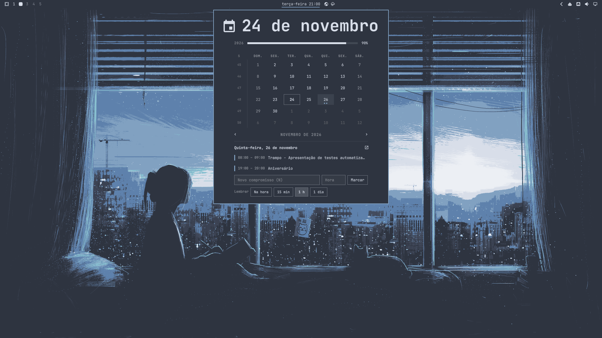

# Agenda



A calendar for [Omarchy](https://omarchy.org) that actually reminds you of
things.

I switched to Omarchy and missed one thing: a simple place to write down
appointments and get a notification before they happen. Everything I found
was either a full calendar suite or synced to some account I didn't want.
So I built my own: keyboard-first, local, and in the same look as the rest of
the desktop.

Pick a day, press Space, type what and when, choose when to be reminded,
save. That's it.

## What it does

- **Reminders that don't get lost.** At the start, 5, 10, 15 or 30 minutes,
  1 or 2 hours, 1 or 2 days, or a week before, as many as you want. They show
  up as normal Omarchy notifications, even after a reboot. If the computer
  was off when a reminder was due, it still arrives when you turn it back on,
  as long as the appointment hasn't ended.
- **Remembers how you like it.** New appointments start with the reminders
  you used last. All-day reminders count back from 09:00.
- **Repeats** daily, weekly, monthly or yearly.
- **Feels like part of Omarchy.** It follows the theme and the language live
  (English, Português, Español).
- **Your data stays with you.** Everything lives in
  `~/.local/share/agenda/events.json`, saved atomically, so a crash in the
  middle of a save won't corrupt it.

Under the hood, reminders are sent by `agenda-reminders.timer`, a systemd user
timer that runs `agenda remind` every minute. The window turns it on when it
opens and tells you if it can't.

## Shortcuts

Made to be used without touching the mouse:

| Key | Action |
| --- | --- |
| Space / N | New appointment on the selected day |
| Enter / E | Edit the selected appointment |
| J / K | Next / previous appointment of the day |
| Delete / X | Delete the selected appointment |
| ← → | Previous / next day |
| ↑ ↓ | Previous / next week |
| PgUp / PgDn | Previous / next month |
| T | Go to today |
| Ctrl+Z / Ctrl+Shift+Z | Undo / redo |
| Ctrl+Enter | Save the appointment being edited |
| Esc | Close (asks before discarding changes) |
| ? | Show all shortcuts |
| Q | Quit |

You can also double-click a day to add an appointment there.

Typing dates and times is forgiving, because I write them a lot of different
ways:

- Dates: `24/11`, `24/11/2026`, `2026-11-24`, `today`, `tomorrow`, `hoje`, `amanhã`
- Times: `14`, `14:30`, `1430`, `14h30`

## Command line

Everything the window does also works from the terminal, which makes it easy
to script:

```sh
agenda list [--from DATE] [--days N] [--json]
agenda add --title "Dentist" --date 2026-12-03 --start 14:30 --remind 60,1440
agenda add --title "Ana's birthday" --date 2026-12-10 --all-day --repeat yearly
agenda edit ID --start 16:00
agenda remove ID
agenda remind            # what the timer runs
```

Every command takes `--json` and exits 0 or 1, with errors on stderr.

## Build and test

```sh
bin/build      # build/agenda
bin/test       # unit tests, run offscreen
bin/install    # makepkg -fsi, then enables the reminder timer
```

It needs `qmake6`, `make`, a C++ compiler, and Qt 6 base, declarative and
Wayland. All of these already come with Omarchy.

I work in QA, so the tests were not optional. `bin/test` runs the whole suite
offscreen, with no window and no display needed.

## About

Made by Gabriel, a QA tester from Araçatuba, Brazil, who wanted a calendar that
fit his desktop. Issues and suggestions are welcome.
